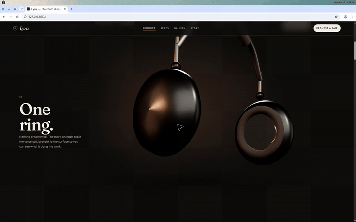
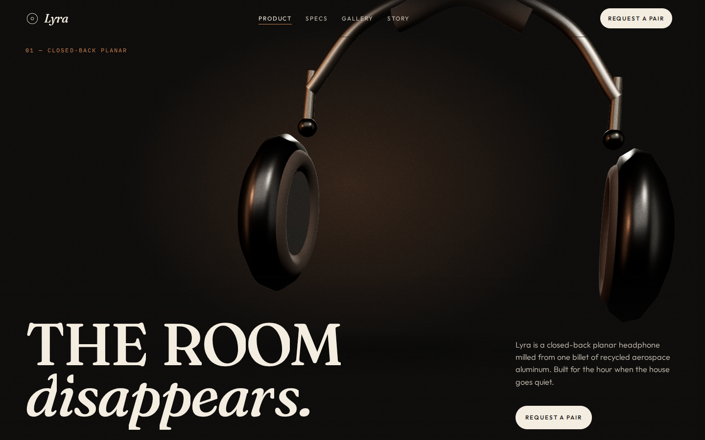
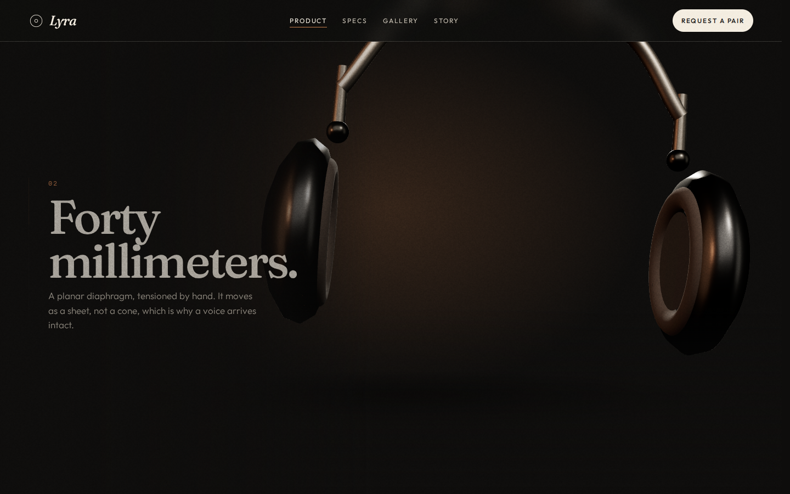
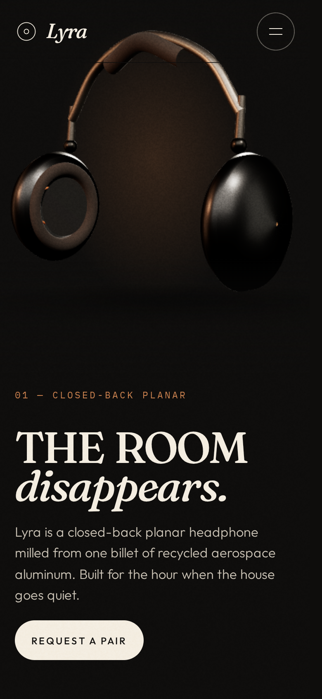

# Kinetic

**Lyra** is a closed-back planar headphone that does not exist. This is its launch site: a scroll-driven product film you can open in a browser, built by [Akhilendra Singh](https://github.com/AkhilSingh2) as proof of motion, WebGL, and interface craft.





The model is not a downloaded file. It is lathe and tube geometry, lit like a studio shot, and it turns as the chapter changes.



On a phone the same page drops the pin, the custom cursor, and the heavy pixel ratio, and keeps the type.



## What it demonstrates

- A pinned, scrubbed story in the manner of a game launch site: one idea at a time, the object held in frame, the next sentence replacing the last.
- A plate that grows from a window until it is the room, and only then lets the line appear. Content coming out of content.
- A real-time product render in React Three Fiber, lazy-loaded, paused when it leaves the screen, with a small fragment shader on the driver.
- Kinetic type, a magnetic cursor, and a hover distortion shader that exists only while a pointer is on a plate.
- Route changes through four pages — product, specs, gallery, story — with a designed curtain and the View Transitions API under it.
- A reduced-motion path that is the same writing without the choreography, and a phone layout that does not pretend to be the desktop.

## Techniques

| Technique | Where it lives |
| --- | --- |
| GSAP timelines and `expo.out` type | `src/pages/Product.tsx`, `src/components/PageHero.tsx` |
| ScrollTrigger pins and scrub | Product page: chapter, emerge plate, horizontal materials |
| Lenis smooth wheel, native touch | `src/components/SmoothScroll.tsx` |
| Procedural headphone, IBL lightformers | `src/components/hero/Headphone.tsx` |
| Driver fragment shader | Same file |
| Raw WebGL hover distortion | `src/lib/distort.ts` |
| View Transitions API plus an ivory curtain | `src/components/Transition.tsx` |
| `prefers-reduced-motion` | `index.html`, `useReducedMotion`, CSS `html.motion` |

The design system — color, type, motion, voice — is [docs/DESIGN.md](docs/DESIGN.md). A study guide with exercises is [docs/LEARNING.md](docs/LEARNING.md). Licenses and what was generated rather than downloaded are in [docs/CREDITS.md](docs/CREDITS.md).

## Stack

- Vite, React 19, TypeScript
- React Router
- GSAP ScrollTrigger (free plugin; no Club plugins)
- Lenis
- Three.js, React Three Fiber, drei
- Fraunces, Outfit, and IBM Plex Mono via Fontsource (SIL Open Font License)
- Playwright, ESLint, GitHub Actions
- Static build, SPA fallback for Vercel

## Run

```bash
npm install
npm run dev
```

Then open the URL Vite prints. Other commands:

```bash
npm run typecheck
npm run lint
npm test
npm run build
npm run preview
npm run assets    # regenerate the gallery plates and the grain tile
```

Tests build the site and run six Chromium smoke checks: the hero, the four routes, the phone menu, the reserve dialog, the 404, and the preloader.

## Deploy

The build is a static `dist/` folder. [vercel.json](vercel.json) sets the Vite framework and rewrites unknown paths to `index.html`, so `/specs`, `/gallery`, and `/story` survive a refresh.

On Vercel, import the repository and leave the defaults. `npm run build` already typechecks before it emits files.

## Routes

| Path | Page |
| --- | --- |
| `/` | The instrument. Hero, pinned chapters, the scaling plate, materials. |
| `/specs` | The numbers, and a drawn response curve. |
| `/gallery` | Six original studies. Hover distortion on a fine pointer. |
| `/story` | Why the object refuses an app, a lamp, and active noise control. |

“Request a pair” opens a dialog. There is no list. Lyra is a study.

## License

MIT, for the site code. See [LICENSE](LICENSE) and [docs/CREDITS.md](docs/CREDITS.md). The fonts stay under the SIL Open Font License.
